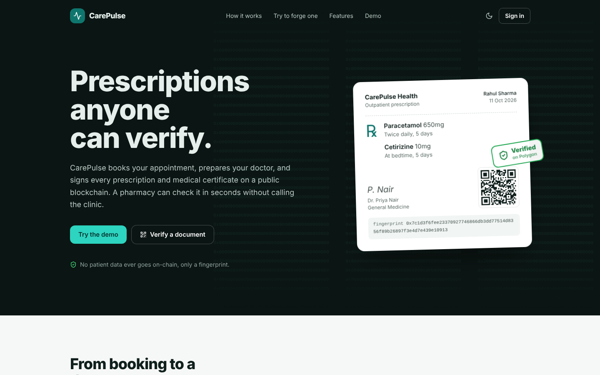
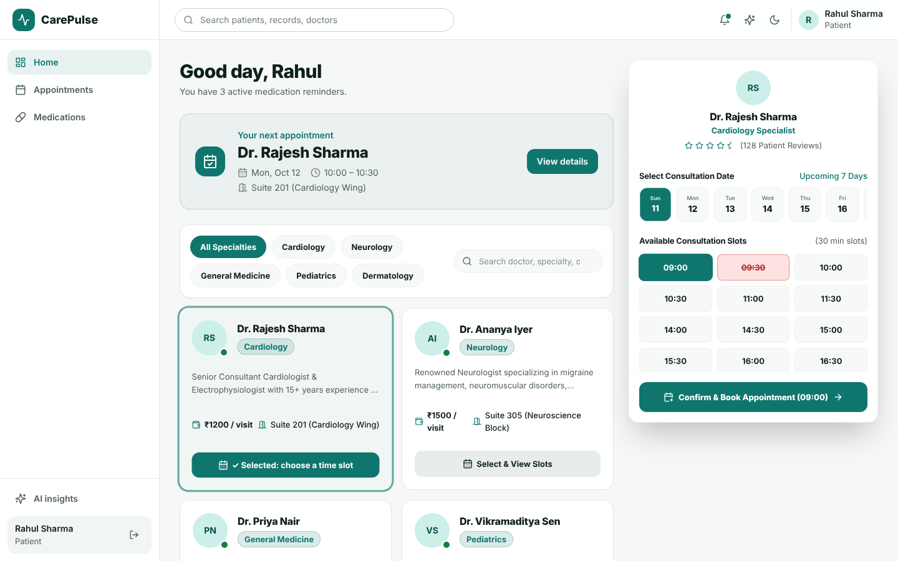
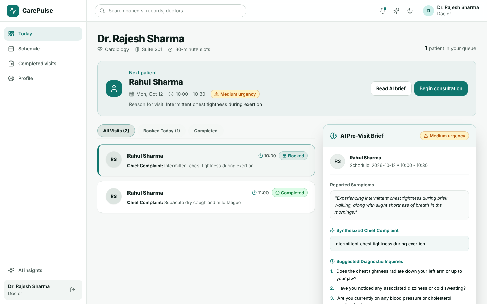
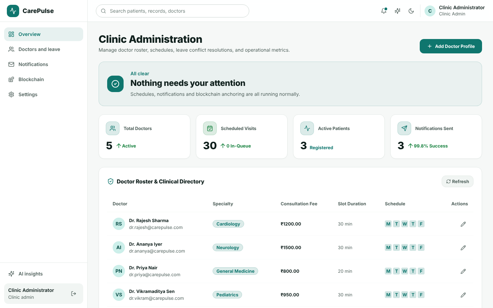
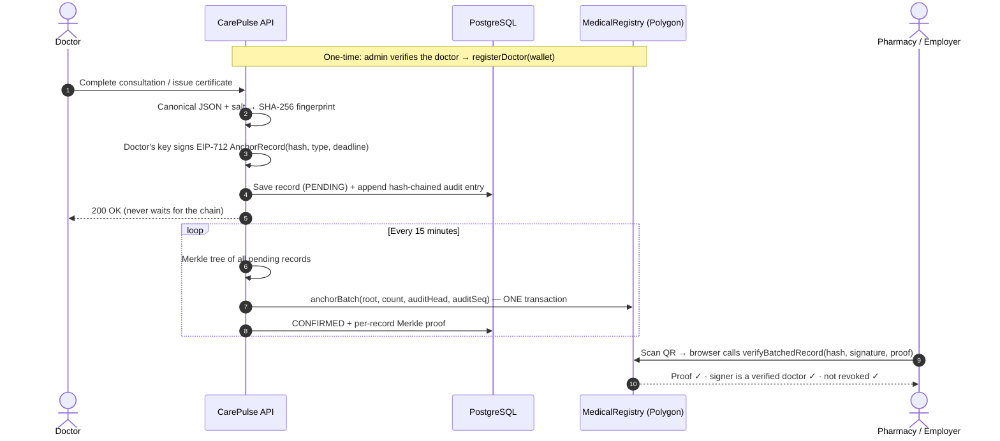

# 🏥 CarePulse — AI-Powered Healthcare Appointment & Clinical Intelligence Platform

[](https://www.typescriptlang.org/)
[](https://react.dev/)
[](https://vitejs.dev/)
[](https://nodejs.org/)
[](https://expressjs.com/)
[](https://www.postgresql.org/)
[](https://neon.tech/)
[](https://www.prisma.io/)
[](https://tailwindcss.com/)
[](https://ai.google.dev/)
[](https://soliditylang.org/)
[](https://hardhat.org/)
[](https://docs.ethers.org/v6/)
[](https://polygon.technology/)

A full-stack healthcare appointment management platform engineered with modern dark-mode clinical glassmorphism, animated WebGL backgrounds, AI-powered symptom triage, post-visit clinical translations, calendar synchronization, temporary appointment holds, automated medication reminders, and **blockchain-verified prescriptions and medical certificates** that anyone can check without trusting the hospital's servers.

---

## 🖥️ Application Preview

### 🔐 Authentication & Portal Access



### 👤 Patient Portal — Specialist Discovery & Slot Booking



### 🩺 Doctor Clinical Station — AI Pre-Visit Brief & Patient Queue



### 👑 Clinic Administration — Telemetry & Schedule Management



## 🌐 Live Demo

**Live Application:** [CarePulse Live Web App](https://carepulse-healthcare-appointment.vercel.app/)

---

## 📑 Table of Contents

1. [Tech Stack](#-tech-stack)
2. [Core System Capabilities](#-core-system-capabilities)
3. [Key Architectural Highlights](#-key-architectural-highlights)
4. [Blockchain Verification](#%EF%B8%8F-blockchain-verification)
5. [Testing Credentials](#-testing-credentials)
6. [Directory Structure](#-directory-structure)
7. [Getting Started](#-getting-started)
8. [Environment Variables](#-environment-variables)
9. [API Endpoint Reference](#-api-endpoint-reference)
10. [Deployment Architecture](#-deployment-architecture)
11. [License](#-license)

---

## 🛠️ Tech Stack

### Frontend

* **Framework:** React 18 with Vite
* **Language:** TypeScript
* **Styling:** Tailwind CSS with custom glassmorphism design tokens
* **Interactive Background:** Custom WebGL canvas and clinical ECG pulse effects
* **Icons:** Google Material Symbols Outlined & Lucide React
* **State Management:** React Context API with JWT-based authentication

### Backend & Database

* **Runtime:** Node.js 18+ with Express.js REST API
* **Language:** TypeScript
* **ORM:** Prisma
* **Database:** Neon Cloud PostgreSQL
* **Authentication:** JWT with `jsonwebtoken`
* **Password Security:** `bcryptjs`
* **Validation:** Zod

### AI & Clinical Intelligence

* **Primary AI Engines:** Google Gemini API and OpenAI API
* **Symptom Triage:** AI-assisted urgency classification (`LOW`, `MEDIUM`, `HIGH`)
* **Fallback Engine:** Deterministic rule-based triage fallback for temporary AI API failures or rate limits

### Automation & Communications

* **Scheduled Workers:** `node-cron`
* **Slot Hold Management:** Expired hold cleanup
* **Medication Reminders:** Automated scheduled alerts
* **Email:** Nodemailer with HTML clinical templates and retry logging
* **Calendar:** Google Calendar OAuth2 + RFC-5545 `.ics` generation

---

# 🌟 Core System Capabilities

## 1. 👤 Patient Portal

* **Specialist Discovery:** Browse specialists across Cardiology, Dermatology, Neurology, General Medicine, and Pediatrics.
* **Slot Booking:** Real-time appointment availability with a **10-minute temporary slot hold**.
* **Double-Booking Prevention:** Database-level uniqueness constraints combined with transactional booking logic.
* **AI Symptom Triage:** Pre-visit questionnaire with urgency assessment and suggested diagnostic questions.
* **Consultation Schedule:** View upcoming and completed appointments with `.ics` calendar downloads.
* **Medication Reminders:** Prescription schedules with dosage, frequency, meal instructions, and automated alerts.
* **AI Clinical Insights:** Interactive symptom checker and clinical platform insights.

## 2. 🩺 Doctor Clinical Station

* **Live Patient Queue:** Chronological daily appointment queue.
* **AI Pre-Visit Brief:** Chief complaint summaries, urgency indicators, and AI-generated diagnostic questions.
* **Consultation Builder:** Create diagnoses, prescriptions, dosage instructions, and medication schedules.
* **AI Care Plan Translation:** Convert complex clinical instructions into clearer patient-friendly guidance.
* **Medication Automation:** Automatically create reminder schedules from prescribed medications.

## 3. 👑 Clinic Administration Portal

* **Real-Time KPIs:** Doctors, appointments, patients, and notification delivery metrics.
* **Specialist Management:** Configure consultation fees, rooms, working hours, and slot durations.
* **Doctor Leave Management:** Identify conflicting appointments and transition affected bookings to `REQUIRES_RESCHEDULE`.
* **Rescheduling Notifications:** Automatically send patients direct rescheduling links.
* **Notification Audit Log:** Track pending, sent, and failed transactional notifications.
* **Blockchain Doctor Registry:** Verify, suspend, or reinstate doctors on-chain and monitor Merkle-batch anchoring.
* **Tamper-Evident Audit Log:** Hash-chained history of clinic actions, checked against on-chain checkpoints.

---

# 🏗️ Key Architectural Highlights

### Double-Booking Prevention

CarePulse combines:

1. Application-level availability checks
2. Prisma transactions for the booking workflow
3. A database unique constraint on `(doctorId, date, startTime)`

The database constraint provides the final protection against concurrent conflicting bookings.

### 10-Minute Slot Holds

A `SlotHold` record temporarily reserves a selected slot using a unique `holdToken` and `expiresAt` timestamp.

Expired holds are ignored by availability queries and can also be explicitly released.

### Doctor Leave Handling

Existing bookings affected by doctor leave transition to:

```text
REQUIRES_RESCHEDULE
```

instead of being treated as simple cancellations. Patients receive a direct rescheduling link.

### Reliable Notifications

Notifications are persisted in `NotificationLog` with:

```text
PENDING
SENT
FAILED
```

Failed deliveries record the error and retry count. Background workers can retry failed notifications without causing the original appointment or consultation operation to fail.

For detailed architecture and failure-handling decisions, see [`SYSTEM_DESIGN.md`](SYSTEM_DESIGN.md).

---

# ⛓️ Blockchain Verification

Forged and altered medical documents are a real problem: a dosage changed with a pen, a sick-leave note with extra days, or a prescription that was never issued at all. CarePulse makes **prescriptions and medical certificates independently verifiable**: each one is fingerprinted, signed with the issuing doctor's key, and anchored to a public blockchain through the `MedicalRegistry` smart contract. A pharmacist, employer or insurer scans the QR code and the browser checks the chain directly. If one character was changed, verification fails.

### What is (and is not) stored on-chain

| On-chain (public, permanent) | Off-chain (private, in PostgreSQL) |
| --- | --- |
| Merkle roots of salted SHA-256 record fingerprints | Full prescription / certificate, patient name, clinical notes |
| Verified doctors' wallet addresses, names, specializations | The random salt, the exact canonical document, each record's Merkle proof |
| Batch time, revocations | Hash-chained audit log of every booking, cancellation, consultation and record |
| One hash per batch committing to the whole audit log | Anchoring status, retries, transaction hashes |

**No patient data ever touches the chain.** A public ledger is permanent, so writing health data to it would violate HIPAA / India's DPDP Act. A 32-byte random salt is mixed into every record before hashing, so a short prescription like "Paracetamol 500mg twice daily" cannot be brute-forced back out of its hash. The audit log isn't published event by event either, which would leak how busy the clinic is and how often someone visits; only a single hash per batch goes on-chain.

### How it works



### Merkle-batched anchoring

Instead of one transaction per document, the server collects every new record over an interval (default **15 minutes**), builds an [OpenZeppelin Merkle tree](https://github.com/OpenZeppelin/merkle-tree) and anchors only the **root**, together with the current audit-log head, in a single transaction. Each record keeps its Merkle proof, and verification is a free `view` call.

| Measured on Hardhat | Gas |
| --- | --- |
| Anchor 1 record on its own | 80,742 |
| Anchor a batch of 50 records + audit checkpoint | 138,956 (**~29× cheaper per record**) |

The batch cost is constant whatever its size, so savings grow with volume (500 records ≈ 290× cheaper per record).

Batching doesn't weaken trust in the hospital: **every leaf commits to the signing doctor**, and `verifyBatchedRecord` re-checks that doctor's EIP-712 signature against the registry. The hospital can't slip in a record a doctor never signed, attribute one to the wrong doctor, or use a doctor who was suspended at batch time. Set `BLOCKCHAIN_BATCH_INTERVAL_MINUTES=0` for one transaction per record instead (same signatures, same contract).

### Medical certificates

After a consultation, the doctor can issue a **sick-leave, fitness, or visit certificate** (dates + remarks). It is signed, batched and verified exactly like a prescription. The patient gets a printable certificate with a QR code; an employer or college scans it to confirm it's genuine and that the rest dates weren't changed. Re-issuing revokes the previous certificate on-chain.

### Tamper-evident audit log

Bookings, cancellations, completed consultations, issued and revoked records, doctor changes and leave decisions are written to an append-only log in which **each entry contains the hash of the previous one**. Editing, deleting or reordering any entry breaks every hash after it. An attacker with database access could recompute the whole chain, so each batch also anchors the latest entry hash on-chain, and the admin **Verify integrity** check compares the log against those on-chain checkpoints. Only IDs and statuses are logged, never symptoms, notes or medicines.

### Design decisions

* **Signature-based authorization (EIP-712 + relayer).** Records are accepted only with a valid typed-data signature from an active, hospital-registered doctor. *Who* submits the transaction doesn't matter: the hospital's relayer wallet pays gas, so doctors never need crypto. Signatures are bound to the chain ID and contract address (no cross-deployment replay) and carry a deadline.
* **Hospital-managed registry.** The hospital (contract owner, `Ownable2Step`) verifies doctors on-chain. Suspending a doctor blocks new records while keeping earlier ones valid.
* **Edits revoke the old version.** Updating a prescription or certificate revokes the previous version on-chain with the doctor's signature, so no stale-but-valid copy survives.
* **Trust-minimized verification.** `/verify` re-hashes the document *in the browser* and reads the contract *directly* through a public RPC. Downloaded files carry their own Merkle proof, so they can be verified even if CarePulse's servers are down or compromised.
* **Never blocks the clinic.** Anchoring runs in the background: batches are claimed atomically, transactions are sent sequentially with automatic nonce recovery, and a batch interrupted by a crash is reconciled against the chain on restart. If the blockchain is down, consultations still complete.
* **Key custody.** For an out-of-the-box demo, each doctor's signing key is derived on the server from `BLOCKCHAIN_DOCTOR_KEY_SECRET`. In production this would move to a KMS/HSM or doctors' own wallets (e.g. MetaMask). The contract is unchanged either way, because it only checks signatures.

### Verification outcomes

| Result | Meaning |
| --- | --- |
| ✅ **Authentic** | In an anchored batch, signed by a verified doctor, not revoked, document unchanged |
| ⛔ **Revoked** | Genuinely issued but later revoked (e.g. replaced by a corrected version) |
| ⛔ **Altered** | Content or signature doesn't match what was anchored: treat as forged |
| ⛔ **Not issued by a verified doctor** | Signed by an unknown key, or by a doctor suspended at the time |
| ⏳ **Pending** | Signed and waiting for the next batch (the page shows the expected time) |

### Smart contract

[`blockchain/contracts/MedicalRegistry.sol`](blockchain/contracts/MedicalRegistry.sol) (Solidity 0.8.24, OpenZeppelin 5):

| Function | Who | Purpose |
| --- | --- | --- |
| `registerDoctor(wallet, name, specialization, credentialHash)` | Hospital | Verify a doctor |
| `setDoctorActive(wallet, bool)` | Hospital | Suspend / reinstate |
| `anchorBatch(root, leafCount, auditHead, auditSeq)` | Hospital | Anchor a Merkle root + audit checkpoint |
| `verifyBatchedRecord(hash, type, deadline, signature, batchId, proof)` | Anyone (free `view`) | Proof + doctor signature + registry checks |
| `revokeBatchedRecord(hash, type, doctor, batchId, proof, deadline, signature)` | Anyone (relayer) | Revoke with the issuing doctor's signature |
| `anchorRecord` / `revokeRecord` / `verifyRecord` | — | Single-transaction mode |
| `adminRevokeRecord(hash)` | Hospital | Revoke any record (fraud investigation) |

**Tests:** 33 Hardhat unit tests (forgery, insider attribution, tampered proofs, expired and replayed signatures, suspension timing, revocation rights, audit-sequence rules, gas comparison) and a 20-step integration test that drives the server's blockchain code against a live local chain.

### Running it

```bash
# 1. Contract: compile, test, start a local chain
cd blockchain
npm install
npx hardhat test                 # 33 passing
npx hardhat node                 # keep running in its own terminal

# 2. Deploy (prints the env values to copy) — local or Polygon Amoy testnet
npm run deploy:local             # or: npm run deploy:amoy  (needs a funded BLOCKCHAIN_RELAYER_PRIVATE_KEY)

# 3. Server: set BLOCKCHAIN_* in server/.env (see Environment Variables), then
cd ../server
npm run prisma:push              # adds the record, batch and audit tables
npm run test:blockchain          # integration test against the local chain
npm run dev
```

Then, as **admin**, open the **Blockchain** tab and click **Verify on-chain** for each doctor. Complete a consultation as a doctor and issue a certificate from **Records**. Records are anchored at the next batch, or immediately with **Anchor now** in the admin Blockchain tab, after which the patient's visit shows **Verified on blockchain** badges, QR codes and downloadable verifiable copies.

> Free testnet POL for Amoy: [faucet.polygon.technology](https://faucet.polygon.technology/). Without the `BLOCKCHAIN_*` variables the app runs normally with anchoring switched off; on the standalone Vercel demo (no backend), records are fingerprinted in the browser and clearly labelled *demo, not on-chain*. If you re-seed the database, deploy a fresh contract too, because the audit log restarts below the last on-chain checkpoint.

### Roadmap

* Doctors signing with their own wallets (MetaMask) instead of server-held keys
* Publishing each batch's record list to an indexer so third parties can audit batch contents

---

# 🔑 Testing Credentials

The following accounts are pre-seeded for local/demo testing.

### 👑 Administration

| Role  | Email                 | Password   |
| ----- | --------------------- | ---------- |
| Admin | `admin@carepulse.com` | `admin123` |

### 🩺 Doctors

| Specialist          | Field            | Email                     | Password    |
| ------------------- | ---------------- | ------------------------- | ----------- |
| Dr. Rajesh Sharma   | Cardiology       | `dr.rajesh@carepulse.com` | `doctor123` |
| Dr. Ananya Iyer     | Dermatology      | `dr.ananya@carepulse.com` | `doctor123` |
| Dr. Vikram Malhotra | Neurology        | `dr.vikram@carepulse.com` | `doctor123` |
| Dr. Amit Verma      | General Medicine | `dr.amit@carepulse.com`   | `doctor123` |
| Dr. Priya Patel     | Pediatrics       | `dr.priya@carepulse.com`  | `doctor123` |

### 👤 Patients

| Patient      | Email               | Password      |
| ------------ | ------------------- | ------------- |
| Rahul Sharma | `rahul@example.com` | `password123` |
| Pooja Verma  | `pooja@example.com` | `password123` |
| John Doe     | `john@example.com`  | `password123` |

> These credentials are intended for demo/testing environments only.

---

# 📁 Directory Structure

```text
Healthcare/
├── client/
│   ├── src/
│   │   ├── api/
│   │   ├── blockchain/
│   │   │   ├── canonical.ts         # Browser-side fingerprinting
│   │   │   └── chain.ts             # Direct on-chain reads (lazy-loaded ethers)
│   │   ├── components/
│   │   │   ├── AIInsightsModal.tsx
│   │   │   ├── AuditLogPanel.tsx
│   │   │   ├── BlockchainAdminPanel.tsx
│   │   │   ├── BlockchainBadge.tsx
│   │   │   ├── IssueCertificateModal.tsx
│   │   │   ├── VerifiableDocumentModal.tsx
│   │   │   ├── CarePulseBackground.tsx
│   │   │   ├── FluidShaderCanvas.tsx
│   │   │   ├── PrescriptionModal.tsx
│   │   │   ├── Sidebar.tsx
│   │   │   ├── SymptomModal.tsx
│   │   │   └── TopAppBar.tsx
│   │   ├── context/
│   │   │   └── AuthContext.tsx
│   │   ├── pages/
│   │   │   ├── AdminDashboard.tsx
│   │   │   ├── AuthPage.tsx
│   │   │   ├── DoctorDashboard.tsx
│   │   │   ├── PatientDashboard.tsx
│   │   │   └── VerifyPage.tsx       # Public /verify page (QR target)
│   │   ├── types/
│   │   ├── App.tsx
│   │   ├── index.css
│   │   └── main.tsx
│   ├── package.json
│   └── vite.config.ts
│
├── blockchain/                      # Hardhat project
│   ├── contracts/
│   │   └── MedicalRegistry.sol      # Doctor registry + signed record anchoring
│   ├── scripts/
│   │   ├── deploy.ts                # Deploys + exports ABI to server & client
│   │   └── export-abi.ts
│   ├── test/
│   │   ├── MedicalRegistry.test.ts        # registry, single-record anchoring
│   │   └── MedicalRegistry.batch.test.ts  # Merkle batches, audit checkpoints
│   └── hardhat.config.ts
│
├── server/
│   ├── prisma/
│   │   └── schema.prisma
│   ├── src/
│   │   ├── blockchain/
│   │   │   ├── audit-chain.ts       # Audit-log hash chain
│   │   │   ├── core.ts              # Hashing, Merkle trees, EIP-712 signing, contract client
│   │   │   └── MedicalRegistry.abi.json
│   │   ├── middleware/
│   │   ├── routes/
│   │   │   ├── admin.routes.ts
│   │   │   ├── appointment.routes.ts
│   │   │   ├── auth.routes.ts
│   │   │   ├── consultation.routes.ts
│   │   │   ├── doctor.routes.ts
│   │   │   ├── notification.routes.ts
│   │   │   └── verify.routes.ts     # Public verification API
│   │   ├── services/
│   │   │   ├── audit.service.ts       # Append-only audit log + integrity check
│   │   │   ├── blockchain.service.ts  # Records, certificates, batch worker, registry admin
│   │   │   ├── calendar.service.ts
│   │   │   ├── email.service.ts
│   │   │   ├── llm.service.ts
│   │   │   └── scheduler.service.ts
│   │   ├── db.ts
│   │   ├── index.ts
│   │   ├── seed.ts
│   │   └── types.ts
│   ├── package.json
│   └── tsconfig.json
│
├── SYSTEM_DESIGN.md
├── .env.example
├── package.json
└── README.md
```

---

# 🚀 Getting Started

## 1. Prerequisites

* Node.js 18+
* npm 9+
* Neon PostgreSQL database

## 2. Clone Repository

```bash
git clone https://github.com/Sujal-tyagi17/Healthcare-Appointment.git
cd Healthcare-Appointment
```

## 3. Install Dependencies

```bash
npm run install:all
```

## 4. Configure Environment Variables

Create `server/.env` from `.env.example`:

### Windows PowerShell

```powershell
copy .env.example server\.env
```

### Linux / macOS

```bash
cp .env.example server/.env
```

Set your Neon PostgreSQL connection string:

```env
DATABASE_URL="your-neon-postgresql-connection-string"
```

Add the required JWT, AI, SMTP, and Google Calendar credentials as needed.

## 5. Initialize Database

Push the Prisma schema to Neon:

```bash
npx prisma db push
```

Seed the demo users and data:

```bash
npm run seed
```

## 6. Start Development Server

```bash
npm run dev
```

Frontend:

```text
http://localhost:5173
```

Backend API:

```text
http://localhost:5000/api
```

---

# ⚙️ Environment Variables

| Variable               | Description                       | Required |
| ---------------------- | --------------------------------- | -------- |
| `PORT`                 | Backend HTTP port                 | No       |
| `NODE_ENV`             | Environment mode                  | No       |
| `DATABASE_URL`         | Neon PostgreSQL connection string | Yes      |
| `JWT_SECRET`           | JWT signing secret                | Yes      |
| `CLIENT_URL`           | Frontend URL for CORS             | Yes      |
| `GEMINI_API_KEY`       | Google Gemini API key             | Optional |
| `OPENAI_API_KEY`       | OpenAI API key                    | Optional |
| `SMTP_HOST`            | SMTP server                       | Optional |
| `SMTP_PORT`            | SMTP port                         | Optional |
| `SMTP_USER`            | SMTP username                     | Optional |
| `SMTP_PASS`            | SMTP app password                 | Optional |
| `GOOGLE_CLIENT_ID`     | Google OAuth client ID            | Optional |
| `GOOGLE_CLIENT_SECRET` | Google OAuth client secret        | Optional |
| `GOOGLE_REFRESH_TOKEN` | Google OAuth refresh token        | Optional |
| `BLOCKCHAIN_RPC_URL`   | JSON-RPC endpoint (e.g. Polygon Amoy) | Optional* |
| `BLOCKCHAIN_CHAIN_ID`  | Chain ID (`80002` Amoy, `31337` local) | Optional* |
| `BLOCKCHAIN_REGISTRY_ADDRESS` | Deployed `MedicalRegistry` address | Optional* |
| `BLOCKCHAIN_RELAYER_PRIVATE_KEY` | Hospital wallet: contract owner, pays gas | Optional* |
| `BLOCKCHAIN_DOCTOR_KEY_SECRET` | Master secret for deriving doctor signing keys | Optional* |
| `BLOCKCHAIN_EXPLORER_URL` | Block explorer for links (e.g. `https://amoy.polygonscan.com`) | Optional |
| `BLOCKCHAIN_BATCH_INTERVAL_MINUTES` | Minutes between Merkle batches (default `15`; `0` = one transaction per record) | Optional |
| `BLOCKCHAIN_BATCH_MAX_SIZE` | Max records per batch (default `500`) | Optional |
| `VITE_BLOCKCHAIN_RPC_URL`, `VITE_BLOCKCHAIN_REGISTRY_ADDRESS`, `VITE_BLOCKCHAIN_CHAIN_ID`, `VITE_BLOCKCHAIN_EXPLORER_URL` | Client build vars so `/verify` reads the chain directly from the browser | Optional |

\* Blockchain anchoring is enabled only when all five starred variables are set.

> Never commit `.env` files, API keys, database passwords, or OAuth secrets to GitHub.

---

# 📡 API Endpoint Reference

### Authentication

```text
POST /api/auth/register
POST /api/auth/login
GET  /api/auth/me
```

### Doctors & Availability

```text
GET /api/doctors
GET /api/doctors/:id/availability?date=YYYY-MM-DD
```

### Appointments

```text
POST   /api/appointments/hold
DELETE /api/appointments/hold/:token
POST   /api/appointments/book
GET    /api/appointments
DELETE /api/appointments/:id
GET    /api/appointments/:id/ics
POST   /api/appointments/analyze-symptoms
```

### Consultations

```text
POST  /api/consultations/:id/post-visit
POST  /api/consultations/:id/certificate
GET   /api/consultations/medications
PATCH /api/consultations/medications/:id/toggle
```

### Blockchain Verification (public)

```text
GET  /api/verify/config
GET  /api/verify/:recordHash
```

### Administration

```text
GET    /api/admin/analytics
GET    /api/admin/blockchain
POST   /api/admin/doctors/:id/blockchain/register
POST   /api/admin/doctors/:id/blockchain/status
POST   /api/admin/blockchain/anchor-now
GET    /api/admin/audit
GET    /api/admin/audit/verify
POST   /api/admin/doctors/:id/leave
GET    /api/admin/doctors/:id/leaves
DELETE /api/admin/doctors/:id/leaves/:date
GET    /api/notifications
```

---

# 🌐 Deployment Architecture

CarePulse uses a **split deployment architecture**:

```text
                 ┌────────────────────┐
                 │       Vercel       │
                 │   React + Vite     │
                 │      /client      │
                 └─────────┬──────────┘
                           │
                           │ HTTPS API
                           ▼
                 ┌────────────────────┐
                 │ Railway / Render  │
                 │ Express + Prisma  │
                 │      /server      │
                 └─────────┬──────────┘
                           │
                           │ DATABASE_URL
                           ▼
                 ┌────────────────────┐
                 │   Neon PostgreSQL  │
                 │ Cloud Database     │
                 └────────────────────┘
```

## Frontend — Vercel

Configure:

```text
Root Directory: client
Framework: Vite
Build Command: npm run build
Output Directory: dist
```

Set:

```env
VITE_API_URL=https://your-backend-url/api
```

## Backend — Railway / Render

Configure:

```text
Root Directory: server
Build Command: npm install && npm run build && npx prisma db push
Start Command: node dist/index.js
```

Set the required backend environment variables, including:

```env
DATABASE_URL=your-neon-postgresql-connection-string
CLIENT_URL=https://carepulse-healthcare-appointment.vercel.app
JWT_SECRET=your-secure-jwt-secret
```

Run the seed command only when the deployment requires demo data:

```bash
npm run seed
```

---

# 📜 License

Distributed under the **MIT License**.

Created for modern clinical operations with a focus on reliable appointment management, AI-assisted workflows, and patient follow-up automation.
